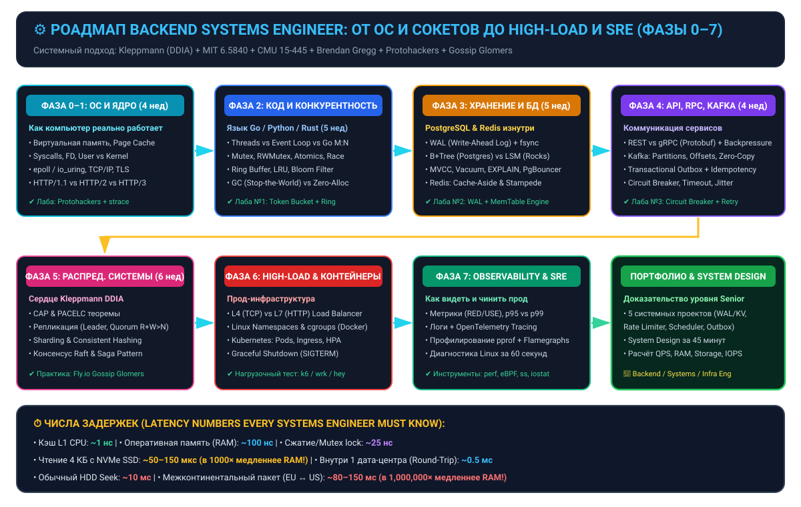

# ⚙️🖥️ ПОЛНЫЙ РОАДМАП: Backend Systems Engineer (От ОС и Сокетов до High-Load и SRE)

> 🧭 **Навигатор:** [[README|Главная]] • [[Чек-лист-Прогресса-Backend-Systems|Чек-лист]] • [[05-Галерея-Схем-Backend-Systems|6 схем пути]] • [[Окно-Быстрых-Вспоминанок-Backend|Окно Вспоминанок]] • [[Все-Проверенные-Источники-Backend-Systems|Книги и Университеты]]

---

## 🧠 Кто такой Backend Systems Engineer (и чем он отличается от обычного CRUD-разработчика)?

Обычный бэкенд-разработчик пишет контроллеры, крутит ORM (`SELECT * FROM users`) и надеется, что фреймворк сам всё сделает.
**Backend Systems Engineer** понимает, что происходит **под капотом** на всём пути запроса:
1. Как сетевой пакет прилетает на сетевую карту Linux, проходит TCP-стек, будится через `epoll` и копируется в память сервиса.
2. Как устроена память, потоки, горутины, планировщик ОС, мьютексы и почему «простая блокировка» ломает производительность под нагрузкой.
3. Как база данных реально хранит байты на диске (`WAL`, `B+Tree`, `LSM-Tree`), как `MVCC` обеспечивает изоляцию без блокировки читателей и почему `PgBouncer` спасает Postgres от смерти.
4. Как строить отказоустойчивые распределённые системы (`Consistent Hashing`, `Raft`, `CAP/PACELC`, `Kafka Outbox`, `Circuit Breaker`), масштабировать до 100,000+ RPS и диагностировать любую поломку продакшна за 60 секунд!

---

## 🗺️ Карта Всего Пути (Фазы 0–7)

| Фаза | Тема | Срок (2 ч/день) | Главный результат и Лаба |
| :---: | :--- | :---: | :--- |
| **0–1** | **Ядро Linux, Память, Сети & Сокеты** | 4 недели | Понимаешь syscalls, FD, виртуальную память, `epoll/io_uring`, TCP/IP, HTTP/1.1–3, TLS, Zero-Copy; решил задачи **Protohackers** |
| **2** | **Системный язык (Go/Rust/Python) & Конкурентность** | 5 недель | Отличаешь Threads vs Event Loop vs Goroutines, понимаешь Mutex/Atomics/GC, Ring Buffer, Bloom Filter + **Лаба №1 (Rate Limiter & Consistent Hashing)** |
| **3** | **Внутренности БД: PostgreSQL & Redis** | 5 недель | Знаешь `WAL + fsync`, `B+Tree` vs `LSM-Tree`, `MVCC`, `VACUUM`, `EXPLAIN ANALYZE`, `PgBouncer`, `Cache Stampede` + **Лаба №2 (WAL + MemTable Engine)** |
| **4** | **gRPC, Apache Kafka & Паттерны Отказоустойчивости** | 4 недели | Строишь сервисы на gRPC/Protobuf, понимаешь партиции Kafka, `Transactional Outbox`, `Idempotency`, `Circuit Breaker` + **Лаба №3** |
| **5** | **Распределённые системы (DDIA & MIT 6.5840)** | 6 недель | Освоил `CAP/PACELC`, кворум `R+W>N`, шардирование, консенсус `Raft`, `Saga`, проблемы времени; прошёл **Fly.io Gossip Glomers** |
| **6** | **High-Load, Балансировка & Контейнеры** | 3 недели | L4 vs L7 балансировщики, Linux `namespaces`/`cgroups` (как устроен Docker!), Kubernetes HPA/Graceful Shutdown, нагрузочные тесты `k6/wrk` |
| **7** | **Observability, SRE & System Design** | Постоянно | RED/USE метрики, `p99` латентность, OpenTelemetry, `pprof`, метод Брендана Грегга за 60 сек + **5 проектов и System Design Interview** |

---

## ⏱️ Главные числа, которые нужно чувствовать «на кончиках пальцев»

- **L1 кэш CPU:** ~1 нс
- **Оперативная память (RAM):** ~100 нс
- **Случайное чтение 4 КБ с NVMe SSD:** ~50–150 мкс *(в 1,000× медленнее RAM!)*
- **Пакет внутри одного дата-центра:** ~0.5 мс
- **HDD Seek:** ~10 мс *(в 100,000× медленнее RAM!)*
- **Межконтинентальный запрос (Европа ↔ США):** ~80–150 мс *(в 1,000,000× медленнее RAM!)*

> **Вывод для архитектуры:** 1 сетевой запрос между микросервисами дороже, чем 10,000 операций в памяти! Поэтому нельзя делать `N+1` запросов к БД или вызывать внешний сервис внутри цикла!

---

## 📌 Краткое содержание каждой фазы

### Фаза 0–1: Ядро ОС, Память, Сокеты и Сети ([[01-Ядро-Linux-Память-Сети-и-Сокеты]])
- Устройство процесса в Linux: User Space (`Ring 3`) vs Kernel Space (`Ring 0`), системные вызовы (`strace`).
- Виртуальная память, Page Cache, `mmap`, почему Linux «ест всю свободную память» под кэш дисков и это хорошо.
- Файловые дескрипторы (`ulimit -n`), сетевые буферы, `SYN Queue` vs `Accept Queue` (`somaxconn`).
- **Как работает C10K/C100K:** почему `epoll` (и современный `io_uring`) в разы быстрее `select/poll`, и как `sendfile()` (Zero-Copy) отправляет файлы напрямую в сеть без копирования в память программы.
- Протоколы: TCP 3-way handshake, `TIME_WAIT`, keep-alive, HTTP/1.1 vs HTTP/2 (Head-of-Line Blocking на уровне TCP) vs HTTP/3 (QUIC поверх UDP), TLS 1.3 handshake.

### Фаза 2: Языки, Многопоточность и Системные Структуры Данных ([[02-Языки-Алгоритмы-и-Многопоточность]])
- Выбор стека системного бэкенда: **Go** (король облачного High-Load и микросервисов), **Rust** (экстремальная производительность без сборщика мусора), **Python** (быстрый прототип и glue-логика; понимание GIL и `asyncio`).
- 3 модели конкурентности: OS Threads (Context Switch + ~2–8 МБ стека), Single-Thread Event Loop (Nginx/Redis/Node), M:N Scheduler (Горутины Go GMP с начальным стеком 2 КБ!).
- Синхронизация и баги: Race Condition, Deadlock, Livelock, Lock Contention, `Mutex` vs `RWMutex` vs `Atomics (CAS)`, False Sharing (кэш-линии CPU 64 байта!).
- Системные структуры: Ring Buffer (LMAX Disruptor), LRU/LFU Cache, Bloom Filter, Skip List, Consistent Hashing, алгоритмы Rate Limiting (Token Bucket, Sliding Window Log/Counter).
- **Практика:** [`lab01_rate_limiter_and_consistent_hashing.py`](../02-Labs/lab01_rate_limiter_and_consistent_hashing.py).

### Фаза 3: Внутренности Баз Данных — PostgreSQL и Redis ([[03-Базы-Данных-PostgreSQL-Redis-и-Kafka]])
- **Как данные ложатся на диск:** Write-Ahead Log (`WAL`), `fsync()`, Checkpoint, `B+Tree` (PostgreSQL, быстрое чтение и диапазоны) vs `LSM-Tree` (RocksDB/Cassandra, максимальная скорость записи + Compaction + Bloom Filters).
- **PostgreSQL изнутри:** архитектура процессов (почему нужен `PgBouncer`), `MVCC` (`xmin/xmax`, почему читатели не блокируют писателей), `Dead Tuples` и `Autovacuum`, 4 уровня изоляции (`Read Committed`, `Repeatable Read`, `Serializable`), аномалия Write Skew и `SELECT FOR UPDATE`, чтение `EXPLAIN (ANALYZE, BUFFERS)`.
- **Redis как системный инструмент:** однопоточный Event Loop (почему `KEYS *` — смертный грех на проде), стратегии кэширования (Cache-Aside, Write-Through), защита от **Cache Stampede** (`Singleflight`) и **Cache Penetration** (`Bloom Filter`).
- **Практика:** [`lab02_wal_and_lsm_storage_engine.py`](../02-Labs/lab02_wal_and_lsm_storage_engine.py).

### Фаза 4: gRPC, Kafka и Паттерны Отказоустойчивости ([[03-Базы-Данных-PostgreSQL-Redis-и-Kafka]])
- **gRPC & Protobuf:** бинарная сериализация, контракты `.proto`, потоки (Streaming), обязательные дедлайны (`context.WithTimeout`), Backpressure.
- **Apache Kafka:** топики, партиции (порядок только внутри 1 партиции!), Consumer Groups, Offset commit, Zero-Copy и почему Kafka быстрее RabbitMQ на потоках.
- **Надёжная доставка без потерь:** семантики *At-most-once / At-least-once / Effectively-once*, **Idempotency Keys**, **Transactional Outbox + CDC (Debezium)** против проблемы двойной записи (*Dual Write*).
- **Отказоустойчивость:** Timeout + Retry с **Exponential Backoff + Full Jitter**, **Circuit Breaker** (Closed / Open / Half-Open), **Bulkhead**, Graceful Degradation.
- **Практика:** [`lab03_circuit_breaker_and_idempotency.py`](../02-Labs/lab03_circuit_breaker_and_idempotency.py).

### Фаза 5: Распределённые системы ([[04-Распределенные-Системы-HighLoad-и-SRE]])
- Теоремы **CAP** и **PACELC** (`CP` vs `AP`, реальный смысл на собеседовании).
- Репликация: Single-Leader (Replication Lag и чтение своих записей), Multi-Leader, Leaderless / Dynamo-стиль (`R + W > N`, Sloppy Quorum, Hinted Handoff).
- Шардирование: Range vs Hash vs Consistent Hashing + проблема горячего ключа (*Celebrity Problem*).
- Консенсус **Raft** (Leader Election, Log Replication, кворум `N/2 + 1`, защита от **Split-Brain**), Distributed Locks (`Fencing Tokens`!), распределённые транзакции **Saga** (vs 2PC) и ловушки физических часов (`Clock Skew`, Lamport Clocks, `monotonic clock`).

### Фаза 6–7: High-Load, Контейнеры и SRE ([[04-Распределенные-Системы-HighLoad-и-SRE]] & [[06-5-Проектов-Портфолио-и-System-Design-Interview]])
- **Балансировка:** DNS Anycast, CDN, L4 (IPVS/Maglev) vs L7 (Envoy/Nginx), Graceful Shutdown (порядок: убрать из балансировщика ➔ дождаться активных запросов ➔ закрыть БД).
- **Контейнеры без магии:** Docker как комбинация **Linux Namespaces** (изоляция видимости) + **cgroups** (лимиты CPU/RAM/OOM) + **OverlayFS**; Kubernetes (Pods, Probes: Liveness vs Readiness, HPA).
- **Observability & SRE:** 3 столпа (Метрики RED/USE и перцентили `p95/p99`, JSON-логи с `trace_id`, OpenTelemetry-трейсы), `pprof` + Flamegraphs, чек-лист диагностики Linux за 60 секунд (Брендан Грегг), SLI/SLO/SLA и Error Budget.
- **Выход на Senior-уровень:** 5 системных проектов в портфолио + алгоритм System Design Interview за 45 минут.
