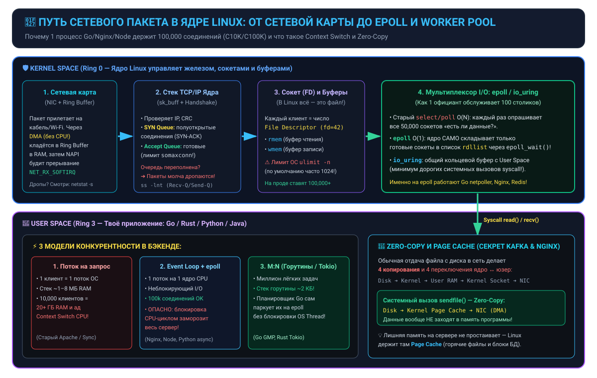

# 🐧🖧 01. Ядро Linux, Виртуальная Память, Сокеты и Сетевой Стек

> 🧭 **Связанные материалы:** [[Полный-Роадмап-Backend-Systems-Engineer|Роадмап]] • [[02_linux_kernel_epoll_network_path.svg|Схема: Ядро и epoll]] • [[Окно-Быстрых-Вспоминанок-Backend|Окно Вспоминанок]]

---

## 🧠 1. User Space vs Kernel Space и Системные вызовы (Syscalls)

Процессор работает в двух главных режимах (кольцах защиты):
- **Ring 3 (User Space):** здесь крутится твой код на Go / Python / Rust. Прямого доступа к железу (диску, сетевой карте, физической RAM) у него нет.
- **Ring 0 (Kernel Space):** здесь живёт ядро Linux.

Чтобы прочитать файл или отправить пакет по сети, программа делает **Системный вызов (`syscall`)**: `read()`, `write()`, `openat()`, `socket()`, `epoll_wait()`.

**🔥 Почему это важно для High-Load:**
Каждый `syscall` — это переключение контекста в ядро и обратно (плюс проверки безопасности CPU против Spectre/Meltdown). Если писать в файл или логи по 1 байту в цикле (1,000,000 syscalls), программа «умрёт» на переключениях. Буферизация (`bufio` / batching) сокращает миллион syscalls до 100!

```bash
# Посмотреть, какие системные вызовы реально делает программа (отладка зависаний!):
strace -c -p <PID>          # Сводная таблица, на какие syscalls ушло время
strace -e trace=network ./app # Только сетевые вызовы программы
```

---

## 💾 2. Виртуальная память, Page Cache и OOM Killer

1. **Виртуальная память (`Virtual Memory`):** процесс думает, что ему принадлежит вся память (адреса от `0` до терабайт), а ядро через таблицу страниц (**Page Table + TLB**) отображает только реально используемые страницы по **4 КБ** на физическую RAM.
2. **Page Cache:** если ты видишь в `free -m`, что «свободной памяти осталось 50 МБ», не паникуй! Linux забирает всю свободную оперативку под **Page Cache** (кэш недавно прочитанных файлов и блоков БД). При первом же запросе программы ядро мгновенно отдаст эту память из кэша (`available` память).
3. **`mmap` vs `read/write`:** `mmap` проецирует файл с диска прямо в адресное пространство процесса (используется во многих БД). Но у него коварный минус: ядро само решает, когда скидывать грязные страницы, что мешает строгому контролю ошибок записи.
4. **OOM Killer (Out-Of-Memory Killer):** если серверу или контейнеру реально не хватило RAM, ядро Linux просыпается и **безжалостно убивает самый «жирный» процесс** (`Killed` в терминале, запись `Out of memory: Killed process` в `dmesg -T`).

---

## 🌐 3. Путь сетевого пакета в Linux: `epoll`, `io_uring` и Zero-Copy



### Шаги пути входящего запроса:
1. Пакет попадает на сетевую карту (**NIC**) ➔ через **DMA** (прямой доступ к памяти без участия CPU!) падает в кольцевой буфер **Ring Buffer** в RAM.
2. Драйвер поднимает прерывание (`NAPI` / `NET_RX_SOFTIRQ`), ядро парсит TCP/IP.
3. При TCP-рукопожатии (`SYN ➔ SYN-ACK ➔ ACK`) соединение проходит две очереди:
   - **SYN Queue** (`tcp_max_syn_backlog`) — полуоткрытые соединения, ждущие `ACK`.
   - **Accept Queue** (`somaxconn`) — полностью установленные соединения, ждущие пока твой код вызовет `accept()`. Если сервис тормозит, Accept Queue переполняется и клиенты получают задержки/дропы (видно в `ss -lnt` колонке `Recv-Q`!).
4. Данные попадают в буфер сокета (`rmem`), который представлен как **File Descriptor (FD)** (число). По умолчанию лимит открытых файлов/сокетов в ОС (`ulimit -n`) часто равен всего `1024` — на проде обязательно поднимают до `100,000+`!

### Проблема C10K/C100K: как 1 сервер держит 100,000 соединений?
- **`select` / `poll` (прошлое):** чтобы проверить 50,000 сокетов, программа передаёт ядру весь список целиком ($O(N)$) каждый тик.
- **`epoll` (стандарт Linux):** ты один раз регистрируешь сокеты в ядре (`epoll_ctl`), а дальше зовёшь `epoll_wait()`. Ядро **само складывает только активные сокеты** в готовый список ($O(1)$ по числу активных событий). Именно под капотом `epoll` работают **Go netpoller**, **Nginx**, **Redis**, **Rust Tokio**.
- **`io_uring` (новое поколение Linux 5.1+):** два кольцевых буфера (Submission + Completion) в разделяемой памяти между приложением и ядром — можно отправлять сотни операций чтения/записи за один (или даже ноль!) системных вызовов!

### Zero-Copy (`sendfile`)
Обычная отправка файла с диска клиенту копирует байты 4 раза: `Диск ➔ Kernel Page Cache ➔ Память программы ➔ Kernel Socket Buffer ➔ Сетевая карта`.
Вызов **`sendfile()`** (Zero-Copy) позволяет ядру переслать файл напрямую `Page Cache ➔ Сетевая карта` минуя User Space! Именно так **Nginx** отдаёт статику и **Apache Kafka** пересылает миллионы сообщений в секунду.

---

## 📡 4. Протоколы сети: TCP, HTTP/1.1 vs HTTP/2 vs HTTP/3 и TLS 1.3

| Протокол | Как устроен | Главная особенность и ловушка |
| :--- | :--- | :--- |
| **TCP** | Надёжный поток байтов (не сообщений!). Есть контроль перегрузки (Congestion Control) и повтор потерь | Ловушка **TIME_WAIT**: после закрытия соединения сокет 60 сек ждёт «заблудившиеся пакеты» (при создании тысяч коротких коннектов в секунду кончаются эфемерные порты — лечится **HTTP Keep-Alive / Connection Pooling**!). |
| **HTTP/1.1** | Текстовый протокол, 1 запрос на 1 TCP-соединение одновременно | Страдает от **HTTP Head-of-Line (HoL) Blocking** — браузер вынужден открывать 6 TCP-соединений на домен. |
| **HTTP/2** | Бинарные фреймы + сжатие заголовков HPACK + **мультиплексирование** сотен запросов в 1 TCP-коннекте! | Основа для **gRPC**. Минус: если потерялся **1 TCP-пакет**, ядро останавливает *все* параллельные потоки внутри этого TCP-соединения (**TCP HoL Blocking**). |
| **HTTP/3 (QUIC)** | Работает поверх **UDP**, шифрование TLS 1.3 встроено прямо в транспорт! | Потеря пакета тормозит только 1 поток, а быстрое соединение устанавливается за **1-RTT (или 0-RTT)** — идеально для мобильных сетей! |
| **TLS 1.3** | Современное шифрование трафика (убрали старые дырявые шифры, сократили рукопожатие до **1-RTT**) | Старайся терминировать TLS на Edge/балансировщике (Nginx/Envoy), используя внутренний mTLS между микросервисами. |

---

## 🧪 Практика к этой главе
1. Зарегистрируйся на **https://protohackers.com/** и напиши на Go/Python/Rust свой сырой TCP Echo Server (Задача 0) и Prime Time JSON-line сервер (Задача 1) без HTTP-фреймворков — сразу почувствуешь, что TCP это поток байтов, где одно сообщение может прийти частями!
2. Проверь лимиты на своей машине: `ulimit -n`, `sysctl net.core.somaxconn`, `ss -s`.
