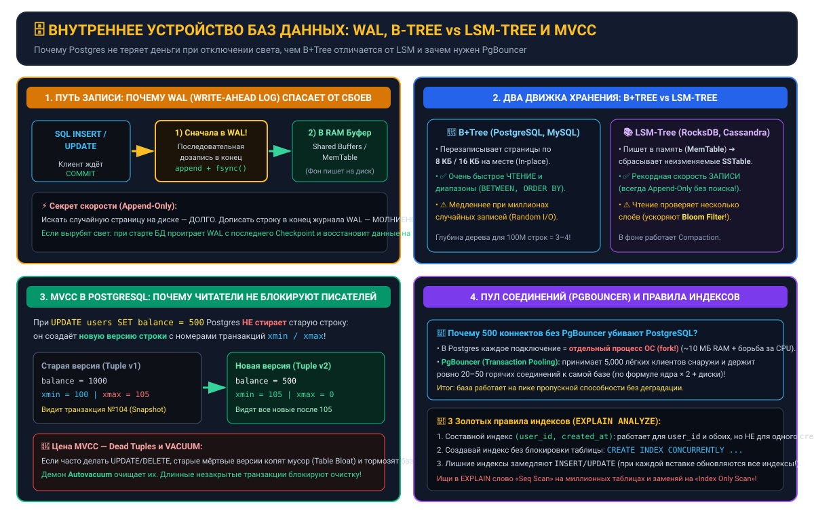
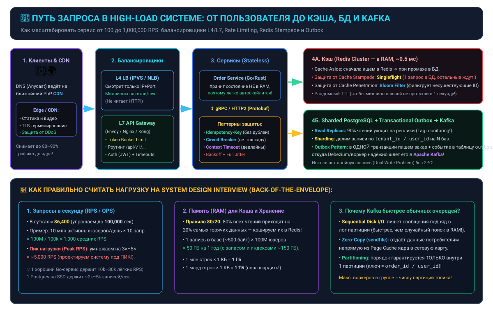

# 🗄️📨 03. Внутренности Баз Данных (PostgreSQL, Redis) и Apache Kafka

> 🧭 **Связанные материалы:** [[Полный-Роадмап-Backend-Systems-Engineer|Роадмап]] • [[03_database_internals_btree_lsm_mvcc.svg|Схема: БД изнутри]] • [[04_highload_architecture_request_path.svg|Схема: High-Load путь]] • [[02-Labs/lab02_wal_and_lsm_storage_engine.py|Лаба №2]]

---

## 💾 1. Как Базы Данных хранят байты на диске: WAL, B+Tree vs LSM-Tree



### Почему база не просто «перезаписывает файл с таблицей» при `UPDATE`?
Если обновлять страницу в середине файла на диске и в этот момент пропадёт электричество, таблица и индекс окажутся наполовину сломанными!
Поэтому в серьёзных БД действует закон **Write-Ahead Log (WAL)**:
1. Перед изменением таблицы запись **сначала последовательно дописывается в конец файла WAL** и сбрасывается на физический диск системным вызовом **`fsync()`**.
2. В оперативной памяти обновляется буфер (`Shared Buffers` или `MemTable`).
3. База отвечает клиенту `COMMIT OK`. А разбросанные страницы данных фоновый процесс скинет на диск позже (при `Checkpoint`).
4. **Если сервер внезапно упал:** при старте БД читает WAL с последнего Checkpoint и **повторяет все закоммиченные операции**, ничего не теряя!

### Два главных движка хранения на рынке:
1. **B+Tree (`PostgreSQL`, `MySQL InnoDB`):**
   - Страницы по 8 КБ / 16 КБ обновляются на месте (*In-place update*).
   - Вся база при 100 миллионах строк имеет высоту дерева всего **3–4 прыжка**!
   - Идеально для быстрого чтения и диапазонов (`WHERE created_at BETWEEN ... ORDER BY ...`). Минус: при миллионах случайных записей генерирует много Random I/O и фрагментацию страниц (*Write Amplification*).
2. **LSM-Tree (`RocksDB`, `Cassandra`, `ScyllaDB`, `LevelDB`):**
   - Записи летят в отсортированную память **MemTable** (и в WAL).
   - Когда MemTable заполняется, она сбрасывается на диск единым последовательным куском — неизменяемым файлом **SSTable**! Никакого поиска места на диске ➔ **бешеная скорость записи**!
   - Фоновый процесс **Compaction** периодически склеивает старые SSTable и удаляет перезаписанные ключи. А чтобы при чтении несуществующего ключа не проверять 20 файлов на диске, перед каждым SSTable в RAM держат **Bloom Filter**!

---

## 🐘 2. PostgreSQL как Системный Инженер: MVCC, Изоляция, Индексы и PgBouncer

### 1. MVCC (Multi-Version Concurrency Control) — почему читатели не ждут писателей
В Postgres каждый `UPDATE` помечает старую версию строки как «умершую в транзакции `xmax = 105`» и создаёт **новую физическую копию строки** с `xmin = 105`.
- Транзакция, начавшаяся раньше (`104`), спокойно читает снимок со старой версией, вообще не блокируя пишущего!
- **Цена MVCC:** старые версии (**Dead Tuples**) занимают место на диске. Фоновый процесс **Autovacuum** обязан их вычищать (иначе база раздувается — *Table Bloat*, а при переполнении 32-битного счётчика транзакций возникает катастрофа *Transaction ID Wraparound*!).

### 2. Уровни изоляции транзакций (Что реально важно при работе с деньгами!)
- **`Read Committed` (по умолчанию в Postgres):** видит только уже закоммиченные данные на момент каждого отдельного SQL-запроса. Ловушка: два параллельных чтения в одной транзакции могут вернуть разные цифры, а проверка баланса + списание без блокировки уйдёт в минус!
- **`Repeatable Read`:** вся транзакция видит замороженный снимок на момент старта. При конфликте обновления одной строки второй транзакции Postgres кидает ошибку `could not serialize access` (нужен retry в коде!).
- **`Serializable`:** полная изоляция (через SSI — Serializable Snapshot Isolation), ловит даже скрытую аномалию **Write Skew** (когда две транзакции читают одно условие, но меняют *разные* строки).
- **Боевой приём для балансов:** `BEGIN; SELECT balance FROM wallets WHERE id = 1 FOR UPDATE; ... COMMIT;` — пессимистичная блокировка строки до конца транзакции (всегда бери строки в одном порядке `ORDER BY id`, чтобы не поймать `Deadlock`!).

### 3. Почему без `PgBouncer` Postgres умирает от 500 подключений?
В PostgreSQL каждое TCP-соединение запускает **тяжёлый отдельный процесс ОС через `fork()`** (~10 МБ RAM + борьба процессов за ядра CPU).
Решение — ставить перед базой **PgBouncer** в режиме **`transaction pooling`**: 3,000 воркеров держат лёгкие коннекты до PgBouncer, а PgBouncer переиспользует всего 30–50 рабочих соединений к самому Postgres!

---

## ⚡ 3. Redis: Кэш, Однопоточность и Защита от Падений

Redis невероятно быстр (~0.2–0.5 мс), потому что **хранит данные в RAM и исполняет команды в 1 главном потоке Event Loop** (никаких гонок и мьютексов!).
- ⚠️ **Главное правило продакшна:** в 1-поточном Redis **ЗАПРЕЩЕНЫ** тяжёлые команды уровня `O(N)` на миллионных ключах (например, `KEYS *` или `HGETALL` огромного хэша) — пока команда выполняется 3 секунды, **стоит вся компания**! Используй `SCAN` с курсором!

### 3 смертельные проблемы кэширования и как их чинят:
1. **Thundering Herd / Cache Stampede:** протух горячий ключ (напр. главная страница маркетплейса), и в ту же миллисекунду 10,000 запросов промахиваются мимо Redis и **обрушивают PostgreSQL**.
   - *Лечение:* **`Singleflight`** (только 1 запрос идёт в базу, остальные 9,999 ждут его результата в памяти) + случайный разброс **Jitter к TTL**.
2. **Cache Penetration:** злоумышленник шлёт миллион запросов с несуществующим `id=-999`. В Redis такого ключа нет ➔ каждый запрос пробивает кэш и бьёт в БД!
   - *Лечение:* кэшировать пустые заглушки (`NULL` с коротким TTL) или проверять существование через **Bloom Filter** до похода в БД.
3. **Cache Avalanche:** сервер кэша упал или перезапустился холодным — база умирает под 100% трафиком.
   - *Лечение:* Redis Sentinel/Cluster, ограничение Rate Limit на вход БД и Circuit Breaker.

---

## 📨 4. gRPC и Apache Kafka (Надёжная коммуникация микросервисов)



1. **gRPC + Protobuf (внутри кластера):** строгий бинарный контракт (`.proto`), сжатие и мультиплексирование поверх **HTTP/2** — в 3–7 раз компактнее и быстрее JSON REST. Главное правило: **всегда пробрасывать `context.WithTimeout` (дедлайны)**, чтобы упавший сервис на конце цепочки не повесил все верхние сервисы!
2. **Apache Kafka:** распределённый неизменяемый лог событий (`Append-Only` на диске + **Zero-Copy `sendfile`**).
   - Топик делится на **Партиции (Partitions)**: строгий порядок сообщений гарантируется **только внутри одной партиции** (поэтому ключ партиционирования — `order_id` или `user_id`).
   - Максимальное количество активных воркеров в одной **Consumer Group** равно числу партиций!
3. **Проблема двойной записи (Dual Write) и Transactional Outbox:**
   - Нельзя просто сделать «сохранить заказ в Postgres + отправить событие в Kafka» — между этими двумя вызовами может отвалиться сеть или свет!
   - **Решение — Transactional Outbox:** в **ОДНОЙ локальной ACID-транзакции** Postgres мы вставляем заказ в `orders` И событие в таблицу `outbox`. Затем фоновый релей или **Debezium (CDC из WAL!)** гарантированно доставляет событие в Kafka (*At-Least-Once*), а получатель защищается от дублей через **Idempotency Key**!

---

## 🧪 Практика к этой главе
1. Запусти **Лабу №2** — она реализует локальный мини-движок хранилища с **Write-Ahead Log (`WAL`)**, **MemTable** в памяти и симуляцией внезапного краша процесса (Crash Recovery):
   ```bash
   python3 02-Labs/lab02_wal_and_lsm_storage_engine.py
   ```
2. Запусти **Лабу №3** — она наглядно демонстрирует работу **Circuit Breaker (Closed ➔ Open ➔ Half-Open)**, **Idempotency Keys** (защита от повторного списания денег при сетевом повторе) и **Exponential Backoff + Full Jitter**:
   ```bash
   python3 02-Labs/lab03_circuit_breaker_and_idempotency.py
   ```
