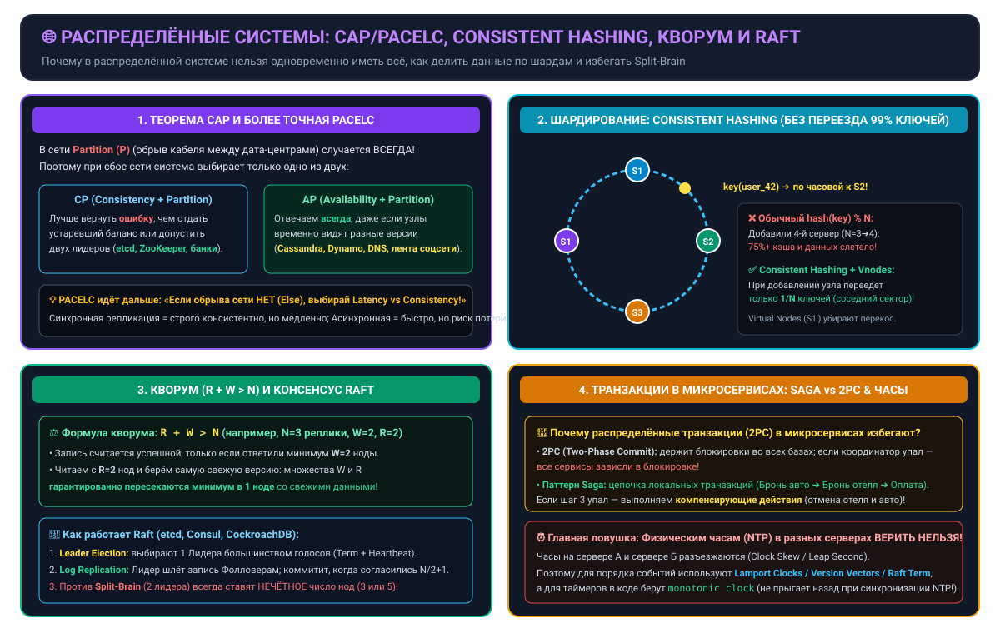
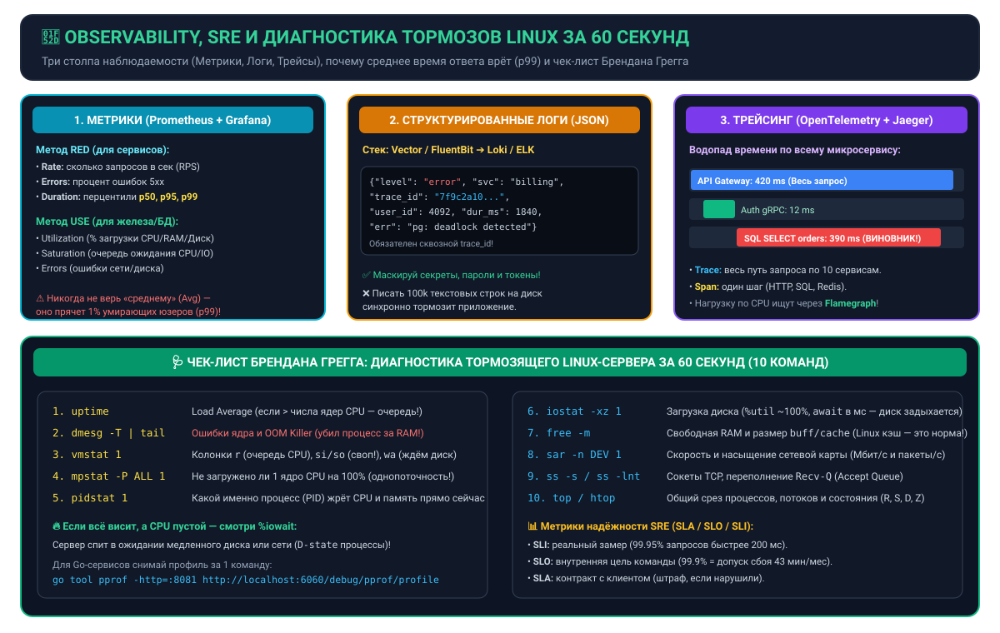

# 🌐🔭 04. Распределённые Системы, Контейнеры и SRE (High-Load в Прод)

> 🧭 **Связанные материалы:** [[Полный-Роадмап-Backend-Systems-Engineer|Роадмап]] • [[05_distributed_systems_cap_sharding_raft.svg|Схема: Распред. системы]] • [[06_observability_sre_troubleshooting_map.svg|Схема: SRE & Диагностика]]

---

## 🌐 1. Распределённые системы (Квинтэссенция Клеппманна DDIA и MIT 6.5840)

### 1. CAP и PACELC (Без заблуждений)
В распределённой сети **Partition (P)** — разрыв связи между серверами или дата-центрами — неизбежен. Поэтому «выбрать CA» в распределённой базе нельзя; при обрыве связи выбор только между:
- **CP (Consistency):** если узлы не слышат кворум, они **отказываются принимать запись/отдавать несвежие данные** (возвращают ошибку). Примеры: `etcd`, `ZooKeeper`, `CockroachDB`, банковские транзакции.
- **AP (Availability):** каждый живой узел продолжает отвечать на запросы, даже если данные между узлами временно разошлись (*Eventual Consistency*). Примеры: `Cassandra`, `Dynamo`, `DNS`, счётчики просмотров.
- **PACELC** уточняет картину: *если разрыва сети (P) нет — **Else (E)** — мы всегда выбираем между **Latency (L)** (асинхронная репликация — быстро, но при падении лидера потеряем пару транзакций) и **Consistency (C)** (синхронная репликация — надёжно, но медленнее)*.

### 2. Репликация и Кворум (`R + W > N`)
- **Single-Leader:** все записи идут на 1 Лидера, чтения распределяются по Read Replicas. Главный баг — **Replication Lag** (пользователь обновил профиль, страница перезагрузилась с отстающей реплики, и он не видит своих изменений!). *Лечение:* **Read-Your-Own-Writes** (первые 5 секунд после записи читать с Лидера).
- **Leaderless (Dynamo-стиль):** запись идёт на $W$ узлов из $N$, чтение с $R$ узлов. Если **`R + W > N`** (например, $N=3, W=2, R=2$), множества чтения и записи гарантированно пересекаются хотя бы в 1 актуальном узле! Конфликты решаются через *Version Vectors*.

### 3. Консенсус Raft и Защита от Split-Brain
Когда нужно выбрать единственного лидера кластера (как в `etcd` внутри Kubernetes):
- Узлов всегда **нечётное количество (3, 5, 7)** — чтобы при развале сети на две половины только одна могла собрать большинство (**кворум `N/2 + 1`**) и избежать **Split-Brain** (двух одновременных лидеров).
- **Fencing Tokens (Токены ограждения):** если ты берёшь распределённый lock в Redis/etcd, а твой процесс завис на 10 секунд из-за паузы GC (Stop-the-World), блокировка протухнет и перейдёт другому воркеру! Проснувшийся первый воркер может перезаписать чужие данные! Чтобы этого не случилось, lock-сервер выдаёт монотонно растущий **Fencing Token (№33, №34)**, а база отвергает устаревший №33!

### 4. Распределённые транзакции: Паттерн Saga и Ловушка Времени
- **2PC (Two-Phase Commit)** в микросервисах не используют из-за блокировок и единой точки отказа координатора. Вместо него применяют **Saga** (последовательность локальных транзакций с компенсирующими событиями при отказе шага).
- **Ловушка времени:** физические часы (`Time of Day` / NTP) на серверах могут **идти назад** или расходиться на десятки миллисекунд! Для порядка событий используйте **Lamport Clocks / UUIDv7 / автоинкремент**, а для замера длительности таймаутов в коде — **Monotonic Clock** (`time.Now()` в Go, `time.monotonic()` в Python).

---

## 🐳 2. Балансировка, Контейнеры изнутри и Graceful Shutdown

1. **L4 (TCP/IP) vs L7 (HTTP/gRPC) балансировщики:**
   - **L4 (`IPVS`, `Maglev`, `AWS NLB`):** смотрит только на IP и порт, пересылает пакеты на скорости ядра (миллионы пакетов/сек), но не понимает URL `/api/users`.
   - **L7 (`Nginx`, `Envoy`, `HAProxy`):** парсит HTTP, умеет роутить по заголовкам, делать Rate Limiting, ретраи и терминировать TLS.
2. **Docker на самом деле — это НЕ виртуальная машина, а 3 механизма ядра Linux:**
   - **`Namespaces` (`pid`, `net`, `mnt`, `uts`, `user`):** изолируют видимость (процесс внутри думает, что он один в системе с `PID 1`).
   - **`cgroups` (Control Groups):** жёстко ограничивают физические ресурсы (не более `2 CPU` и `512 MB RAM` ➔ при превышении сработает OOM Killer контейнера!).
   - **`OverlayFS`:** слоистая файловая система для образов.
3. **Graceful Shutdown (Выключение без 502 ошибок):**
   При получении сигнала `SIGTERM` от Kubernetes сервис НЕ должен мгновенно убивать процесс! Правильный порядок:
   `Переключить Readiness Probe в 503 / убрать из балансировщика` ➔ `перестать принимать новые коннекты` ➔ `подождать завершения текущих запросов (drain)` ➔ `закрыть пул соединений к БД и Kafka` ➔ `выйти с кодом 0`.

---

## 🔭 3. Observability, Перцентили `p99` и Диагностика за 60 секунд (SRE)

1. **Почему «Среднее время ответа 50 мс» — ложь?**
   Если 99 пользователей получили ответ за 20 мс, а 1 VIP-пользователь ждал 3 секунды, среднее выглядит «нормально» (~50 мс), хотя продукт уже деградирует. Всегда меряй **`p95` и `p99`** (хвостовые задержки, *Tail Latency*)!
2. **Три столпа Observability:**
   - **Метрики (`Prometheus + Grafana`):** дешёвые числовые ряды по методикам **RED** (*Rate, Errors, Duration* для сервисов) и **USE** (*Utilization, Saturation, Errors* для CPU/RAM/Диска).
   - **Логи (`JSON + Vector/Loki`):** обязательно содержат сквозной **`trace_id`** и маскируют токены/пароли.
   - **Трейсинг (`OpenTelemetry + Jaeger`):** показывает «водопад» запроса через 10 микросервисов и сразу подсвечивает конкретный медленный SQL или вызов Redis!
3. **Профилирование и eBPF:** в Go подключай **`pprof`** (`CPU profile`, `Heap`, `Goroutines`) и стройте **Flamegraphs** (огненные графики — ширина столбика сразу показывает функцию, сжигающую 70% CPU!). А на уровне ядра для трассировки без правки кода используют **eBPF** (`bpftrace`, `bcc`).
4. **SLI / SLO / SLA и Error Budget:** если твой SLO = `99.9%` доступности в месяц, у команды есть **Error Budget = 43.2 минуты** допустимого простоя в месяц. Пока бюджет не исчерпан — выкатываем новые фичи; если бюджет сожжён сбоями — замораживаем фичи и чиним надёжность!

---

## 🧪 Практика к этой главе
1. Пройди интерактивные распределённые челленджи от Fly.io и создателя Jepsen: **https://fly.io/dist-sys/** (*Gossip Glomers*: Broadcast, Unique IDs, Fault-Tolerant KV Store).
2. Посмотри лекции курса **MIT 6.5840 (Distributed Systems)**: https://pdos.csail.mit.edu/6.824/.
3. Открой [[06-5-Проектов-Портфолио-и-System-Design-Interview|Гайд по 5 проектам и System Design Interview]] и спланируй свой первый системный пет-проект!
