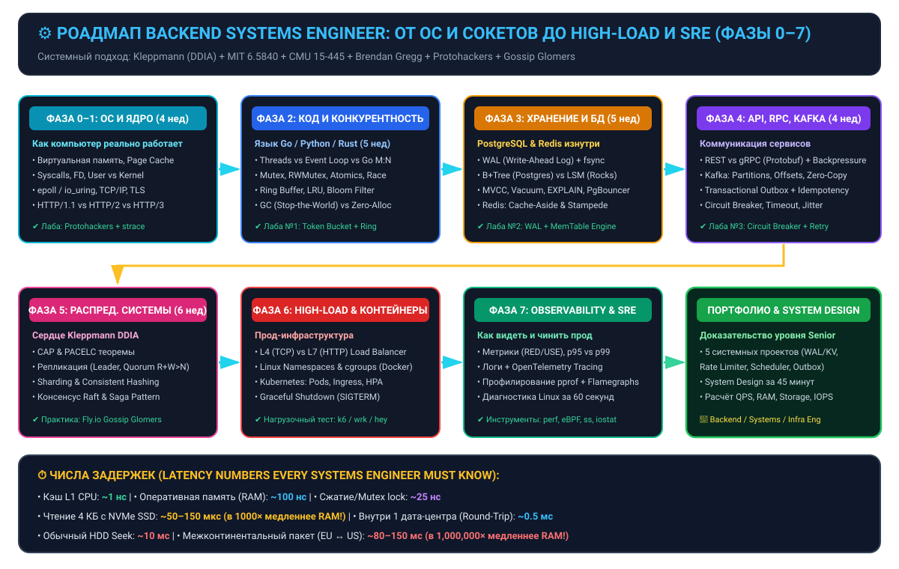
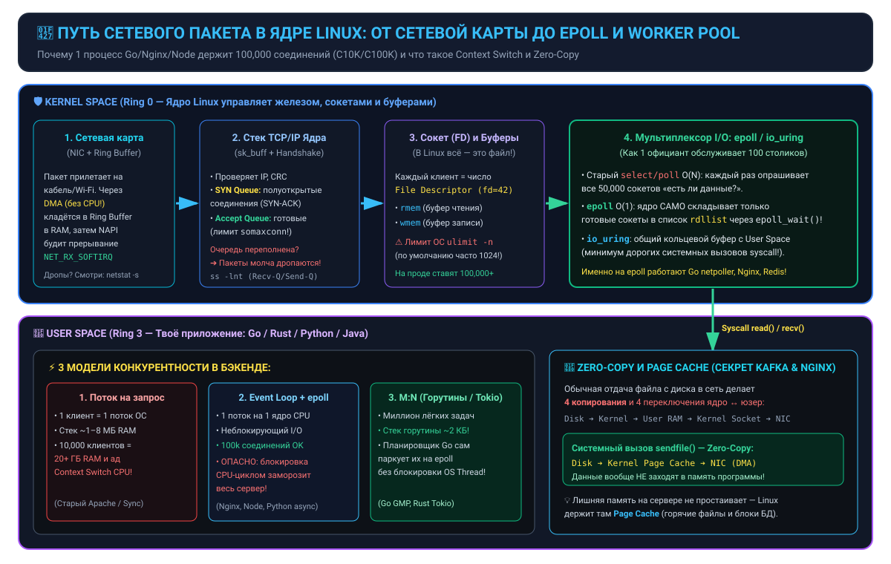
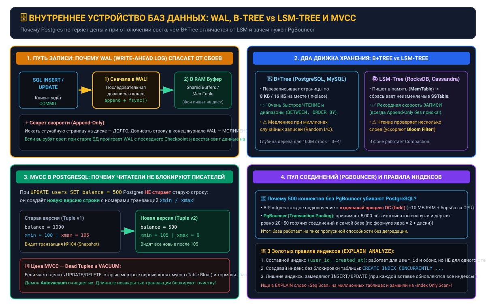
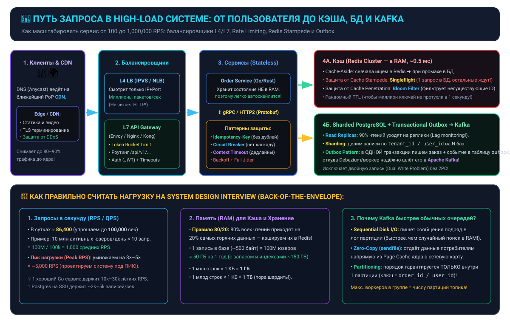
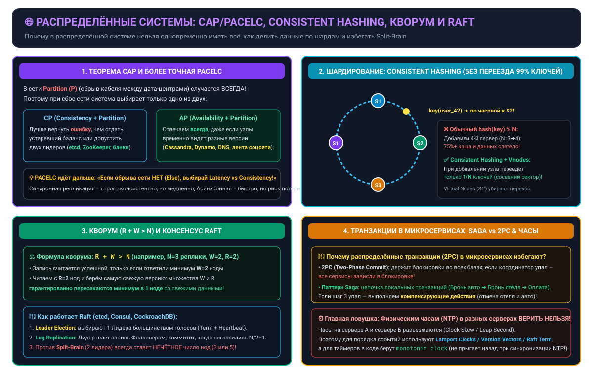
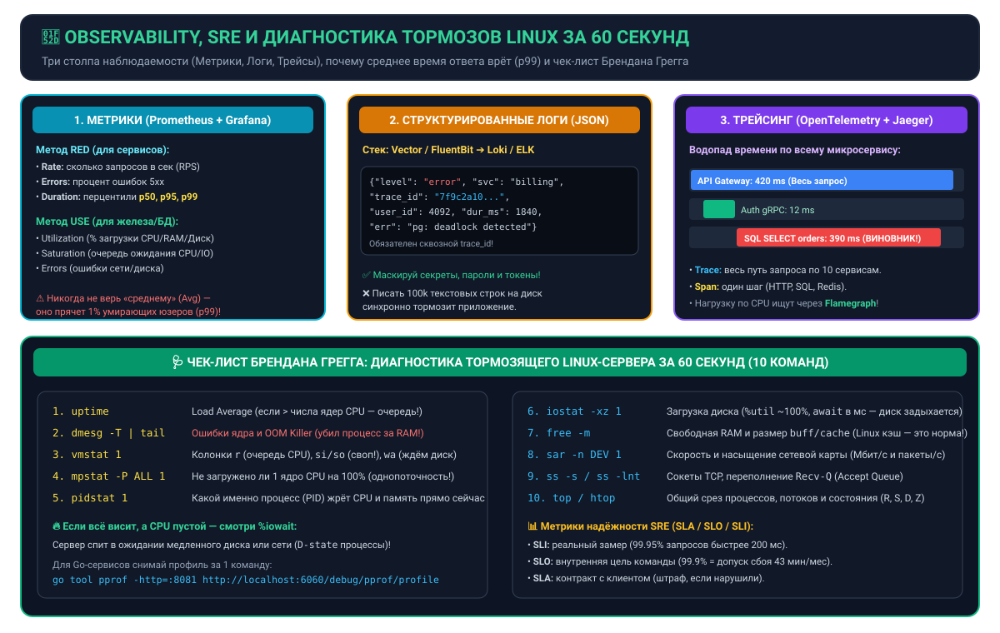

# 🖼️🗺️ Галерея Архитектурных Схем и Системных Путей

> Нажми на любую схему в Obsidian или открой вкладку **«🖼️ Галерея Схем»** на интерактивном сайте [`07-Interactive-Site/index.html`](../07-Interactive-Site/index.html), чтобы увеличить картинку на весь экран!

---

| № | Файл схемы | Что на ней показано |
| :---: | :--- | :--- |
| **01** | [`01_backend_systems_engineer_roadmap.svg`](01_backend_systems_engineer_roadmap.svg) | **Полный роадмап Фаз 0–7 + числа задержек:** от ОС/Linux и сокетов до БД, High-Load, распределённых систем и SRE |
| **02** | [`02_linux_kernel_epoll_network_path.svg`](02_linux_kernel_epoll_network_path.svg) | **Путь пакета в ядре Linux:** NIC ➔ DMA ➔ SYN/Accept Queue ➔ Socket FD ➔ `epoll/io_uring` ➔ 3 модели конкурентности + Zero-Copy |
| **03** | [`03_database_internals_btree_lsm_mvcc.svg`](03_database_internals_btree_lsm_mvcc.svg) | **Устройство БД изнутри:** путь записи в `WAL + fsync`, `B+Tree` (Postgres) vs `LSM-Tree` (RocksDB), `MVCC (xmin/xmax)` и `PgBouncer` |
| **04** | [`04_highload_architecture_request_path.svg`](04_highload_architecture_request_path.svg) | **Путь запроса в High-Load:** CDN ➔ L4/L7 LB ➔ Stateless gRPC сервисы ➔ Redis (Stampede/Bloom) ➔ Sharded DB + Outbox ➔ Kafka + расчёт RPS/RAM |
| **05** | [`05_distributed_systems_cap_sharding_raft.svg`](05_distributed_systems_cap_sharding_raft.svg) | **Распределённые системы:** CAP & PACELC, кольцо Consistent Hashing с виртуальными нодами, кворум `R+W>N`, Raft, Saga и ловушка часов |
| **06** | [`06_observability_sre_troubleshooting_map.svg`](06_observability_sre_troubleshooting_map.svg) | **SRE и диагностика за 60 секунд:** Метрики (RED/USE, p99), JSON-логи, OpenTelemetry-трейсы и 10 команд Брендана Грегга |

---

