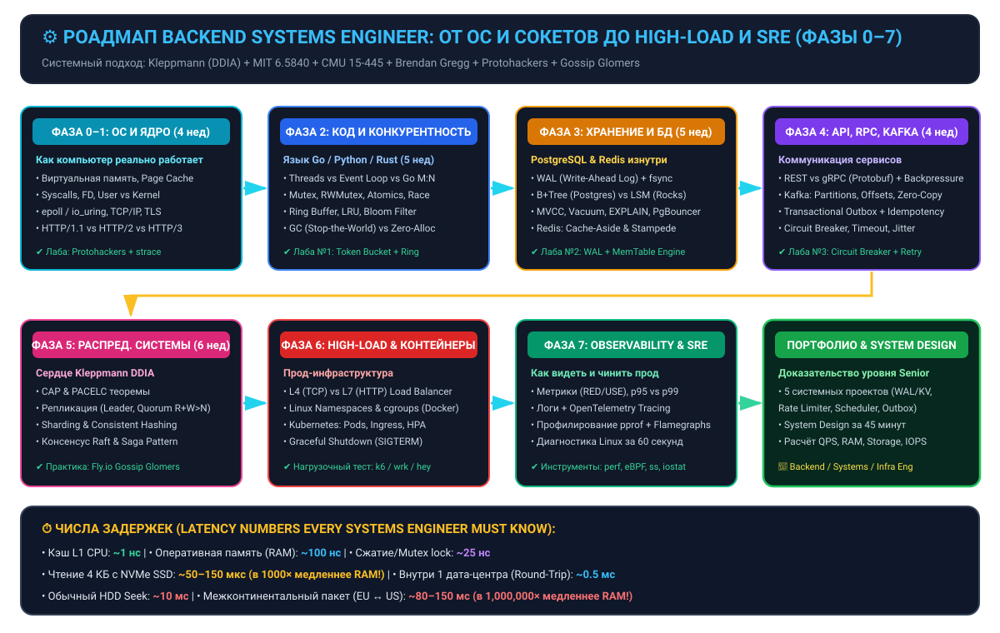
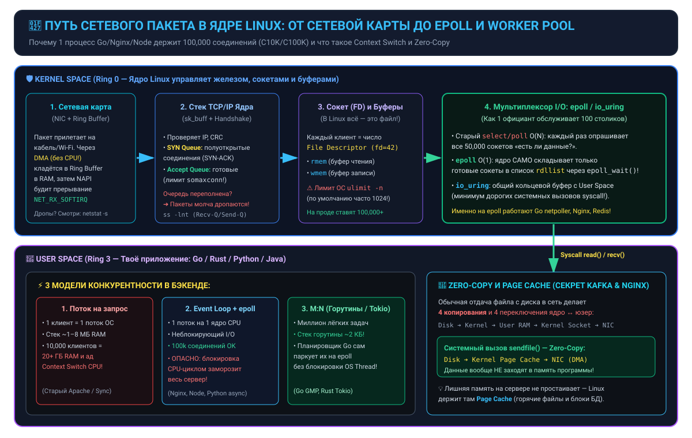
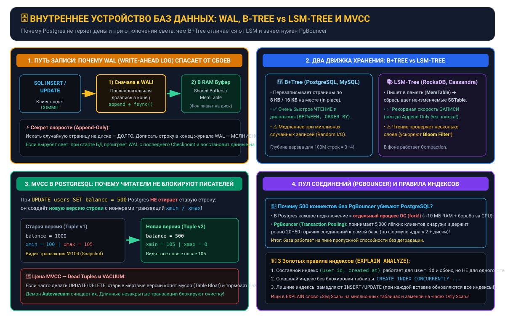
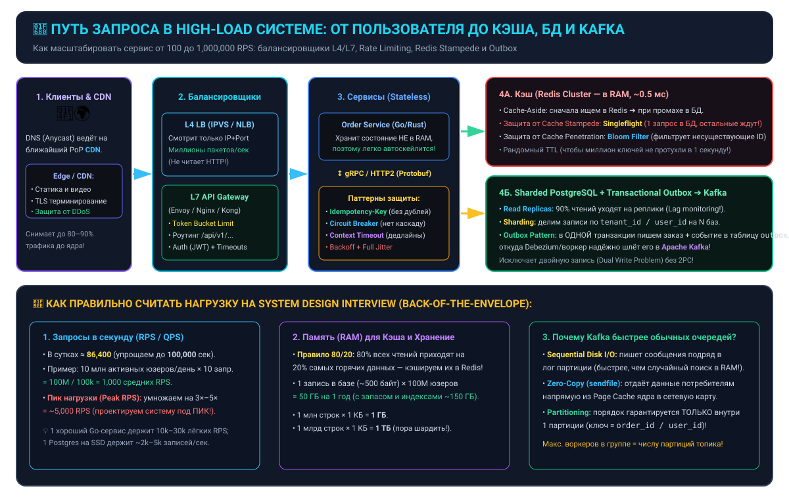
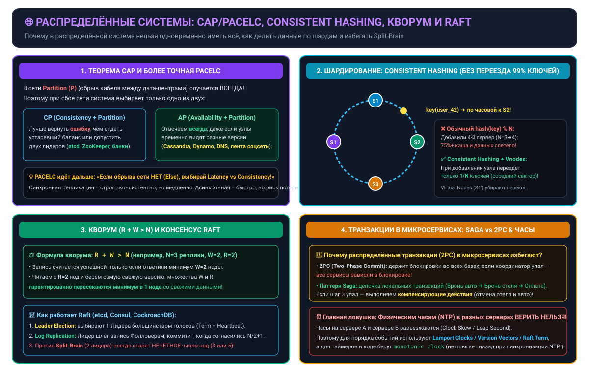
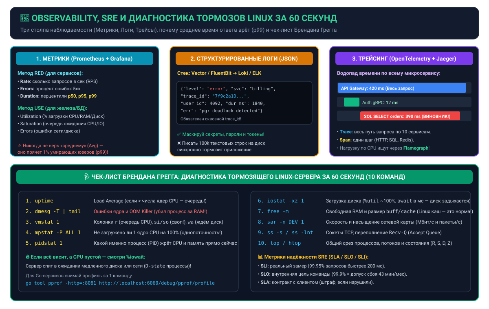

<div align="center">

# ⚙️🖥️ Backend Systems Engineer — Roadmap, Architecture & Labs (`Core-37`)

**Полный системный роадмап с нуля до Senior Backend / Systems Engineer: устройство ядра Linux, `epoll / io_uring`, многопоточность (Go / Rust / Python), внутренности PostgreSQL (`WAL`, `B+Tree` vs `LSM`, `MVCC`, `PgBouncer`), Redis, Apache Kafka (`Transactional Outbox`), распределённые системы (`CAP`, `Consistent Hashing`, `Raft`), Observability & SRE.**


[🗺️ Карта пути](#-2-все-6-архитектурных-схем-и-путей-внутри-систем) • [🌐 Интерактивный сайт](#-1-интерактивная-академия--окно-маленьких-вспоминанок-alt--m) • [🗂️ Структура курса](#-3-структура-репозитория-obsidian--github) • [🧪 3 Python-лабы](#-4-быстрый-запуск-3-системных-python-лабораторий) • [📚 Источники](04-Resources/Все-Проверенные-Источники-Backend-Systems.md)

</div>

---

## 📋 О репозитории (About & Topics)

- **Description:** `Zero-to-Senior Backend Systems Engineer Roadmap, Architecture Encyclopedia & Interactive Academy (Linux Kernel, epoll/io_uring, Go/Rust Concurrency, PostgreSQL WAL/MVCC, Redis, Kafka Outbox, CAP/Raft, High-Load & SRE). 6 visual SVG diagrams, 45+ flashcards & 3 Python labs.`
- **Topics:** `backend`, `systems-engineering`, `distributed-systems`, `system-design`, `highload`, `linux-kernel`, `postgresql`, `golang`, `kafka`, `redis`, `sre`, `roadmap`

---

## 🌐 1. Интерактивная Академия + Окно Маленьких Вспоминанок (`Alt + M`)

Открой в любом браузере локальный файл **[`07-Interactive-Site/index.html`](07-Interactive-Site/index.html)**:
- 🧭 **13 интерактивных разделов**: от ядра Linux и сокетов до БД, High-Load, распределённых систем, SRE и алгоритма System Design Interview за 45 минут.
- 🧠 **Плавающее «Окно Маленьких Вспоминанок» (`Alt + M`)**: выдвигается поверх любого урока, содержит **45+ микро-карточек** с фильтрами, режимом самопроверки `🙈 Скрыть ответы` и формой добавления твоих собственных заметок в `localStorage`.
- 🩺 **Быстрая отладка и SQL**: встроенные шпаргалки метода Брендана Грегга (диагностика тормозов Linux за 60 секунд) и разбора `EXPLAIN (ANALYZE, BUFFERS)`.
- ✅ **Трекер прогресса + бэкап**: галочки сохраняются локально в браузере и повышают твой ранг (`L0 Junior Dev` ➔ `L5 Systems Architect`).

---

## 🖼️ 2. Все 6 Архитектурных Схем и Путей Внутри Систем

> Все схемы в высоком векторном качестве лежат в [`05-Assets/`](05-Assets/05-Галерея-Схем-Backend-Systems.md).

### 1) Полный маршрут Backend Systems Engineer (Фазы 0–7) + числа задержек

*Последовательность освоения тем (ОС ➔ Конкурентность ➔ БД ➔ gRPC/Kafka ➔ Распределённые системы ➔ Контейнеры ➔ SRE) и ключевые тайминги CPU / RAM / NVMe SSD / Сети.*

---

### 2) Путь сетевого пакета в ядре Linux (`NIC ➔ DMA ➔ epoll / io_uring ➔ Zero-Copy`)

*Как один сервер держит 100,000+ соединений (`C10K/C100K`), чем `epoll` и `io_uring` быстрее `select/poll`, как устроены `SYN / Accept Queue`, модель `Go G-M-P` и вызов `sendfile()`.*

---

### 3) Внутреннее устройство БД (`WAL + fsync`, `B+Tree` vs `LSM-Tree`, `MVCC` и `PgBouncer`)

*Почему Postgres не теряет коммиты при сбое питания (`WAL`), разница между `B+Tree` и `LSM-Tree` (`MemTable ➔ SSTable + Bloom Filter`), как работает `MVCC (xmin/xmax)` и зачем нужен `PgBouncer`.*

---

### 4) Путь запроса в High-Load системе (`CDN ➔ L4/L7 LB ➔ Redis ➔ Sharded DB + Outbox ➔ Kafka`)

*Сквозная архитектура высоконагруженного сервиса, защита от `Cache Stampede (Singleflight)` и `Cache Penetration (Bloom Filter)`, паттерн `Transactional Outbox` и расчёт RPS / RAM на собеседовании.*

---

### 5) Распределённые системы (`CAP & PACELC`, `Consistent Hashing`, Кворум `R+W>N`, `Raft`, `Saga`)

*Практический выбор `CP` vs `AP`, масштабирование шардов без протухания 75% кэша, защита от `Split-Brain`, `Fencing Tokens`, паттерн `Saga` и ловушки физических часов (`NTP / Clock Skew`).*

---

### 6) Observability, SRE и диагностика Linux за 60 секунд

*Три столпа наблюдаемости (Метрики `RED/USE` + `p99`, структурные JSON-логи с `trace_id`, OpenTelemetry-трейсы), `SLI/SLO/SLA` и чек-лист из 10 команд Брендана Грегга + `pprof`.*

---

## 🗂️ 3. Структура Репозитория (Obsidian & GitHub)

| Папка | Содержание | Главные файлы |
| :--- | :--- | :--- |
| **`00-Roadmap/`** | Программа Фаз 0–7 и чек-лист прогресса | [`Полный-Роадмап-Backend-Systems-Engineer.md`](00-Roadmap/Полный-Роадмап-Backend-Systems-Engineer.md) • [`Чек-лист-Прогресса-Backend-Systems.md`](00-Roadmap/Чек-лист-Прогресса-Backend-Systems.md) |
| **`01-Theory-Notes/`** | 4 глубоких учебника по системному бэкенду | [`01-Ядро-Linux-Память-Сети-и-Сокеты.md`](01-Theory-Notes/01-Ядро-Linux-Память-Сети-и-Сокеты.md) • [`02-Языки-Алгоритмы-и-Многопоточность.md`](01-Theory-Notes/02-Языки-Алгоритмы-и-Многопоточность.md) • [`03-Базы-Данных-PostgreSQL-Redis-и-Kafka.md`](01-Theory-Notes/03-Базы-Данных-PostgreSQL-Redis-и-Kafka.md) • [`04-Распределенные-Системы-HighLoad-и-SRE.md`](01-Theory-Notes/04-Распределенные-Системы-HighLoad-и-SRE.md) |
| **`02-Labs/`** | 3 рабочие системные Python-лабы (stdlib, без внешних зависимостей) | [`README-Labs.md`](02-Labs/README-Labs.md) • [`lab01_rate_limiter_and_consistent_hashing.py`](02-Labs/lab01_rate_limiter_and_consistent_hashing.py) • [`lab02_wal_and_lsm_storage_engine.py`](02-Labs/lab02_wal_and_lsm_storage_engine.py) • [`lab03_circuit_breaker_and_idempotency.py`](02-Labs/lab03_circuit_breaker_and_idempotency.py) |
| **`03-Cheatsheets-and-Flashcards/`** | Шпаргалки отладки, SQL `EXPLAIN` и 45 карточек | [`Окно-Быстрых-Вспоминанок-Backend.md`](03-Cheatsheets-and-Flashcards/Окно-Быстрых-Вспоминанок-Backend.md) • [`Шпаргалка-Системная-Отладка-SQL-и-Архитектура.md`](03-Cheatsheets-and-Flashcards/Шпаргалка-Системная-Отладка-SQL-и-Архитектура.md) |
| **`04-Resources/`** | Книги (DDIA, Petrov, Gregg), MIT 6.5840, CMU 15-445, Protohackers, Fly.io | [`Все-Проверенные-Источники-Backend-Systems.md`](04-Resources/Все-Проверенные-Источники-Backend-Systems.md) |
| **`05-Assets/`** | 6 векторных архитектурных SVG-схем | [`05-Галерея-Схем-Backend-Systems.md`](05-Assets/05-Галерея-Схем-Backend-Systems.md) |
| **`06-Projects-and-Interview/`** | 5 системных проектов на GitHub + алгоритм System Design | [`06-5-Проектов-Портфолио-и-System-Design-Interview.md`](06-Projects-and-Interview/06-5-Проектов-Портфолио-и-System-Design-Interview.md) |
| **`07-Interactive-Site/`** | Интерактивный веб-сайт обучения и трекер | [`index.html`](07-Interactive-Site/index.html) |

---

## 🧪 4. Быстрый запуск 3 системных Python-лабораторий

```bash
cd 02-Labs

# 1) Token Bucket Rate Limiter + Кольцо Consistent Hashing с 50 виртуальными нодами
python3 lab01_rate_limiter_and_consistent_hashing.py

# 2) Движок KV-хранения с Write-Ahead Log (WAL + fsync), MemTable и Crash Recovery
python3 lab02_wal_and_lsm_storage_engine.py

# 3) Circuit Breaker (Closed/Open/Half-Open) + Idempotency Keys + Exponential Backoff & Full Jitter
python3 lab03_circuit_breaker_and_idempotency.py
```

---

## 🔄 Синхронизация изменений с GitHub

- На **Linux / macOS:** `./push_to_github.sh` (или `git push origin main`)
- На **Windows:** [`push_to_github.bat`](push_to_github.bat)

---

## 👤 Автор и Связанный Репозиторий
- **Автор:** `Core-37` (g37)
- **Связанный репозиторий (AI/ML & AppSec Research Hub):** [`Core-37/AI-Ml-Security`](https://github.com/Core-37/AI-Ml-Security)
